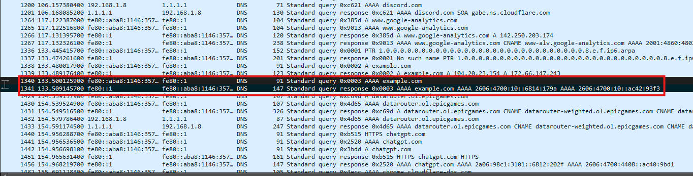
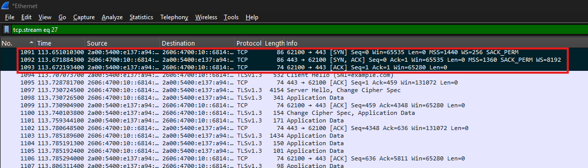
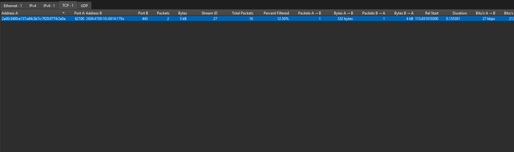

# Wireshark Network Traffic Analysis — Lab Report

## 1. Project overview

**Objective:** inspect DNS, TCP, and TLS traffic in Wireshark and document what the reviewed packets show.

**Tool:** Wireshark on Windows.

**Evidence:** eight screenshots from the analysis. Conclusions are limited to what is visible in the reviewed evidence; packet behavior alone does not establish a root cause.

## 2. Methodology and reproducibility

The screenshots document the use of Wireshark display filters for DNS, TCP stream 27, and TLS handshake messages. The exact capture interface, capture date and duration, and the actions that generated every packet were not reliably recorded in the available project notes. These details are left unspecified rather than invented.

The project currently documents screenshots, not a raw PCAP/PCAPNG file. Therefore, the TShark commands below are reproducibility examples and have not been run against a capture stored in this repository. Replace `capture.pcapng` with the actual local capture filename.

List DNS packets:

```bash
tshark -r capture.pcapng -Y "dns"
```

List TLS handshake packets:

```bash
tshark -r capture.pcapng -Y "tls.handshake"
```

List TCP reset packets:

```bash
tshark -r capture.pcapng -Y "tcp.flags.reset == 1"
```

Export selected DNS fields:

```bash
tshark -r capture.pcapng -Y "dns" -T fields -e frame.number -e frame.time_relative -e ip.src -e ip.dst -e dns.id -e dns.qry.name -e dns.flags.rcode
```

## 3. Findings summary

| Finding | Evidence | Confidence and limitation |
|---|---|---|
| One observed DNS lookup for `example.com` completed successfully | Transaction ID `0x0003`, No error, two IPv6 answers, response time about 9.0198 ms | High for this transaction; not proof all DNS lookups succeeded |
| DNS requests to `192.0.2.1` have no matching response visible in the reviewed evidence | Repeated requests, including a PTR query | High for the visible evidence; cause unknown |
| TCP stream 27 completed connection setup | SYN, SYN-ACK, ACK | High for this flow |
| TLS handshake-related traffic is visible | Client Hello with SNI `example.com` and Server Hello-related traffic | High; negotiated cipher and complete handshake were not established |
| TCP conversation statistics show 16 packets over about 0.155 seconds | Conversations view, local port 62100 and remote port 443 | High for the displayed values |
| A separate TCP reset was observed | Frame 1674 has `RST, ACK` from `192.168.1.8:63591` to `4.207.44.67:443` | High for the packet flags; cause unknown |

## 4. DNS traffic analysis

### 4.1 DNS packet-list overview

The broad DNS packet-list view uses the `dns` display filter to focus on DNS requests and responses.



### 4.2 DNS query details

The query-details view shows an **AAAA query** for `example.com`, requesting IPv6 address information. The packet details reference response frame 1341.

**Display filter:** `dns`


### 4.3 Matching DNS response

The matching response uses transaction ID `0x0003`, reports **No error**, and contains two IPv6 answers. Wireshark reports a response time of approximately **9.0198 ms** for this transaction.

This supports the conclusion that this observed DNS lookup completed successfully; it does not mean every DNS request in the capture succeeded.


### 4.4 DNS requests with no response visible

The reviewed capture shows repeated DNS requests from `192.168.1.8` to `192.0.2.1`. Visible traffic includes the PTR name `1.2.0.192.in-addr.arpa`, a reverse-lookup name for `192.0.2.1`. No matching response is visible in the reviewed evidence.

**Display filter:** `dns`


**Interpretation:** the screenshot shows requests without a visible response in the displayed packets. It does not prove that the default DNS resolver was faulty or establish which command produced the traffic. The address `192.0.2.1` is in the documentation-only range `192.0.2.0/24`; this should not be described as a test of a public DNS resolver.

## 5. TCP three-way handshake

The packet list for TCP stream 27 shows the three connection-setup messages:

1. **SYN** — the client requests to start a TCP connection.
2. **SYN, ACK** — the other endpoint acknowledges the request and responds.
3. **ACK** — the client acknowledges the response.

This sequence indicates that TCP connection setup completed for the observed flow.

**Display filter:** `tcp.stream eq 27`



The packet-details screenshot identifies packet 1092 as **SYN, ACK** and shows TCP stream index 27.


## 6. TLS handshake visibility

The capture includes a TLS Client Hello with SNI `example.com`, followed by Server Hello-related traffic.

**Display filter:** `tls.handshake`


This evidence shows TLS handshake-related messages were visible. It does not establish that every negotiation stage was fully verified, or that encrypted application contents were readable. The current evidence has not been used to assert a negotiated cipher suite, certificate identity, or exact negotiated TLS version.

## 7. TCP conversation statistics

The Wireshark **Statistics → Conversations** window, on the TCP tab, shows a conversation associated with stream 27. The visible statistics include:

- Local port: `62100`
- Remote port: `443`
- Total packets: `16`
- Duration: approximately `0.155 seconds`

This is a statistics view rather than a packet-list view, so there is no display-filter bar in this screenshot.



## 8. Separate TCP reset observation

A separate packet inspected in the capture showed:

```
Frame 1674
192.168.1.8 -> 4.207.44.67
TCP 63591 -> 443 [RST, ACK]
Seq=44432 Ack=4820 Win=0 Len=0
```

Nearby traffic was described in the notes as including TLS Application Data and FIN, ACK packets. The TCP Conversations screenshot above does not display frame 1674, and the evidence set does not include a dedicated screenshot of that frame. The stream ID and complete surrounding packet sequence have not been verified here.

**Interpretation:** `RST, ACK` indicates a TCP reset packet. The flag alone does not reveal why the connection was reset and does not prove that a network fault occurred. The surrounding stream and application context would be needed before assigning a root cause.

## 9. Limitations and data handling

The capture contains both a documentation-range address (`192.0.2.1`) and a public destination (`4.207.44.67`). The available evidence does not establish whether any addresses were anonymized or modified. Do not imply that all traffic belongs to one controlled test without verifying the capture's origin.

The project does not include a raw PCAP/PCAPNG file, so independent packet-level reproduction is limited to the screenshots and the user's local capture if retained. Raw captures may contain sensitive details and should not be published without review and sanitization.

## 10. Conclusion

The screenshots document a DNS query and matching response for `example.com`, separate DNS requests to `192.0.2.1` with no response visible in the reviewed evidence, a TCP three-way handshake, TLS handshake visibility, TCP conversation statistics, and a separately observed TCP reset.

These are packet-analysis findings, not proof of a production outage or a confirmed root cause. The report does not claim that a fault was repaired or that a specific command caused the DNS requests to `192.0.2.1`.
