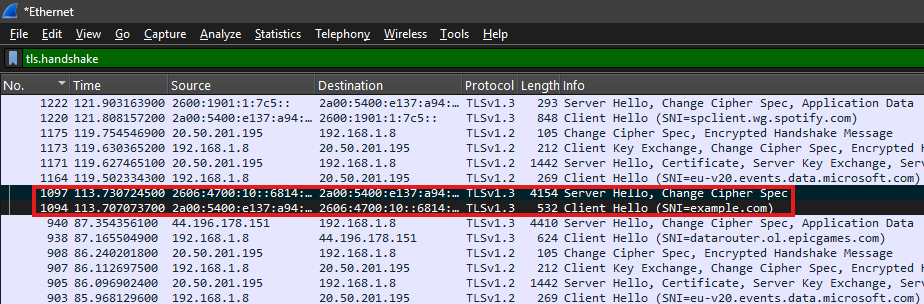

# Wireshark Network Traffic Analysis — Lab Report

## 1. Project overview

**Objective:** inspect real network packets in Wireshark and describe what the captured DNS, TCP, and TLS traffic shows.

**Tool used:** Wireshark on Windows.

**Evidence included:** eight screenshots captured during the analysis. The conclusions below are limited to the packets and statistics visible in those screenshots. A packet pattern by itself does not establish the root cause of a network problem.

## 2. DNS query and response

The capture includes DNS traffic for `example.com`. The query and response details match on DNS transaction ID `0x0003`.

### DNS query

The query-details view shows an **AAAA query** for `example.com`, which requests IPv6 address information. The packet details also reference response frame 1341.

**Display filter used:** `dns`


### DNS response

The matching response shows **No error** and two IPv6 answers. Wireshark reports a response time of approximately **9.0198 ms** for this transaction. This supports the conclusion that this observed DNS lookup completed successfully; it does not establish that every DNS request in the capture succeeded.


### DNS traffic overview

This screenshot provides the broader DNS packet-list view used to identify the DNS traffic.


## 3. DNS request with no response visible

The capture also shows repeated DNS requests from `192.168.1.8` to `192.0.2.1`. The visible query includes the PTR name `1.2.0.192.in-addr.arpa`, which is a reverse-lookup name for `192.0.2.1`. No matching response is visible in the displayed evidence.

**Display filter used:** `dns`


**Interpretation:** this screenshot supports the observation that these requests did not receive a visible response in the displayed packets. It does not, by itself, prove that the normal DNS resolver was faulty or that a deliberate DNS-timeout command was run. The address `192.0.2.1` is in the documentation-only range `192.0.2.0/24`, so this traffic should not be presented as a test of a public DNS server.

## 4. TCP three-way handshake

The TCP stream 27 screenshot shows the connection-setup exchange:

1. **SYN** — the client requests to start a TCP connection.
2. **SYN, ACK** — the other endpoint acknowledges the request and responds.
3. **ACK** — the client acknowledges the response.

Seeing this sequence indicates that TCP connection setup completed for the observed flow.

**Display filter used:** `tcp.stream eq 27`


The packet-details screenshot shows packet 1092 as **SYN, ACK** and identifies its TCP stream index as 27.


## 5. TLS handshake visibility

The capture includes a TLS Client Hello with SNI `example.com`, followed by Server Hello-related traffic. This shows that TLS handshake messages were visible in the captured packets.

**Display filter used:** `tls.handshake`



**Interpretation:** this evidence is useful for identifying TLS negotiation traffic. The screenshot alone should not be used to claim that every stage of the TLS handshake was fully verified, or that encrypted application contents were read.

## 6. TCP conversation statistics

The Wireshark **Statistics → Conversations** window, on the TCP tab, shows a conversation associated with stream 27. The visible statistics include:

- Local port: `62100`
- Remote port: `443`
- Total packets: `16`
- Duration: approximately `0.155 seconds`

This view summarizes the selected TCP conversation. It is a statistics window rather than a packet-list view, so there is no display-filter bar in this screenshot.


## 7. Separate TCP reset observation

A separate packet inspected in the capture showed the following:

```
Frame 1674
192.168.1.8 -> 4.207.44.67
TCP 63591 -> 443 [RST, ACK]
Seq=44432 Ack=4820 Win=0 Len=0
```

Nearby traffic included TLS Application Data and FIN, ACK packets. The reset observation is separate from the TCP Conversations screenshot above; that screenshot does not display frame 1674, and no dedicated screenshot of frame 1674 is included in this report.

**Interpretation:** `RST, ACK` indicates a TCP reset packet. That flag alone does not identify why the connection was reset and does not prove that a network fault occurred. The surrounding stream and application context would be needed before making a root-cause claim.

## 8. Analysis workflow

The work documented in this report follows the packet-analysis steps shown by the evidence:

1. Locate DNS packets with the `dns` display filter.
2. Compare a DNS query with its matching response and inspect the response status and answers.
3. Inspect the DNS requests for which no response is visible in the displayed capture.
4. Use `tcp.stream eq 27` to isolate the TCP exchange and identify SYN, SYN-ACK, and ACK.
5. Use `tls.handshake` to view TLS handshake-related packets.
6. Review the TCP Conversations statistics and inspect a separate TCP reset packet.
7. Keep observations separate from conclusions about root cause.

## 9. Conclusion

The screenshots document a successful DNS query/response for `example.com`, separate DNS requests to `192.0.2.1` with no response visible in the displayed evidence, a TCP three-way handshake, TLS handshake visibility, TCP conversation statistics, and a separately observed TCP reset.

These are packet-analysis findings, not proof of a production outage or a confirmed root cause. The report intentionally does not claim that a fault was repaired or that the DNS requests to `192.0.2.1` were generated by a specific command.

## 10. Privacy and safe sharing

Before sharing screenshots publicly, review them for IP addresses, hostnames, DNS queries, usernames, or other identifying information. Raw PCAP/PCAPNG captures can expose substantially more detail than screenshots, so do not publish them without reviewing and sanitizing them first.
