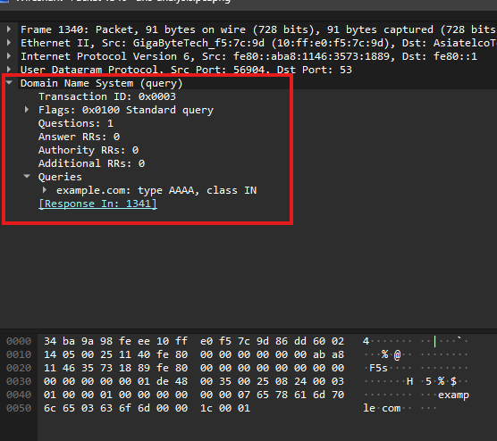
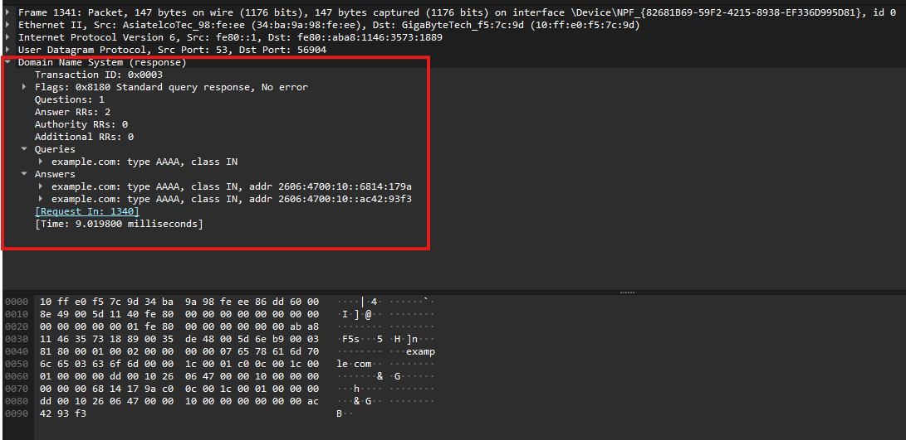
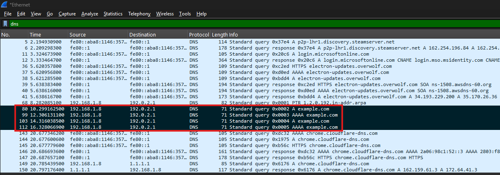
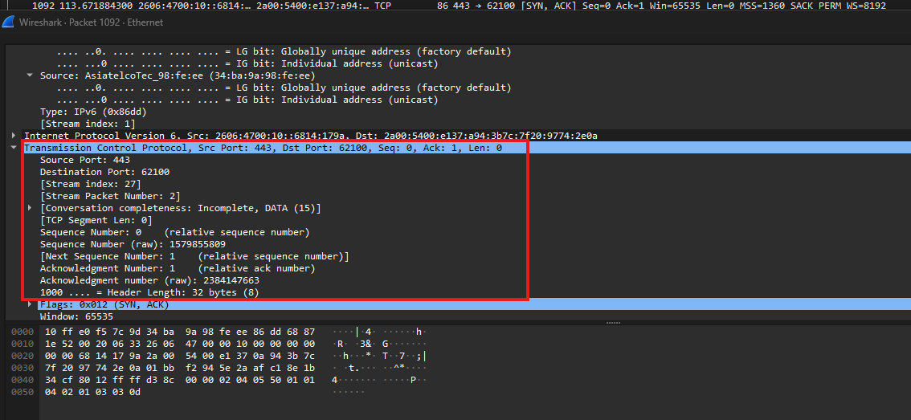

# Wireshark Network Troubleshooting — Lab Report

## 1. Project overview

**Goal:** practise packet-level troubleshooting with Wireshark on Windows by comparing command-line DNS tests with captured traffic and identifying common TCP/TLS behavior.

**Tools:** Wireshark, Windows Command Prompt, `nslookup`.

**Scope:** this is a small lab using captured traffic plus one intentionally unsuccessful DNS query. It does not claim that a production network fault was found or repaired.

**How to read the filters:** a filter described as “shown in screenshot” is the one visibly present in that image. Where a useful filter is suggested for a separate follow-up inspection, it is labelled as a suggested filter rather than presented as if it appeared in the screenshot.

## 2. Successful DNS lookup

**Command used**

```cmd
nslookup example.com
```

**What we observed:** the lookup returned IPv4 and IPv6 addresses. The resolver appeared as `fe80::1` with the label `UnKnown`.

**What it means:** name resolution succeeded for this test. The label `UnKnown` and the phrase “Non-authoritative answer” do not, by themselves, mean DNS is broken.

**Display filter:** `dns` is the broad filter used to view DNS queries and responses. The DNS overview screenshot is cropped so that the filter bar is not visible; the query and response detail screenshots show the selected DNS packet fields rather than the filter bar.

**Evidence — DNS overview**


**Evidence — query packet details**



The query screenshot shows an AAAA query for `example.com`, transaction ID `0x0003`, with a link to response frame 1341.

**Evidence — response packet details**



The response screenshot shows the matching transaction ID `0x0003`, “No error,” and two IPv6 answers. Wireshark reports a response time of about 9.0198 ms.

## 3. Controlled DNS timeout test

**Command used**

```cmd
nslookup example.com 192.0.2.1
```

**Display filter shown in the screenshot**

```
dns
```

The screenshot's green display-filter bar visibly contains `dns`. The highlighted packets show repeated DNS requests from `192.168.1.8` to `192.0.2.1` with no matching response visible in this screenshot.

**Optional narrower filter for a follow-up inspection** — this is a suggested filter, not the one displayed in the screenshot:

```
dns && ip.addr == 192.0.2.1
```

**Interpretation:** `192.0.2.1` belongs to the documentation-only range `192.0.2.0/24`; it is not intended to be a public DNS resolver. This timeout is therefore a controlled demonstration, not proof that the normal DNS service is faulty.

**Evidence**



## 4. TCP three-way handshake

The highlighted packets in the screenshot show the first three packets of TCP stream 27:

1. **SYN** — the client starts the connection.
2. **SYN, ACK** — the server acknowledges the request and responds.
3. **ACK** — the client acknowledges the server response.

This indicates TCP setup completed for the observed flow.

**Display filter shown in the screenshot**

```
tcp.stream eq 27
```

This is the exact filter visible in the screenshot. The previously documented filter `tcp.flags.syn == 1` is another valid way to find SYN packets, but it is **not** the filter shown in this evidence image.

**Evidence**




The packet-details screenshot shows packet 1092 as `SYN, ACK` and identifies its TCP stream index as 27.

## 5. TLS handshake visibility

The capture showed a TLS Client Hello with SNI `example.com`, followed by Server Hello-related traffic. This is evidence that TLS handshake messages were visible in the capture. It does **not** establish that every stage of the TLS negotiation was fully verified.

**Display filter shown in the screenshot**

```
tls.handshake
```

The screenshot's filter bar shows `tls.handshake`. Some displayed rows may include related TLS 1.3 records or encrypted traffic; do not interpret this screenshot alone as proof that all handshake stages were inspected.

**Evidence**


## 6. TCP conversations and reset observation

### TCP Conversations window

The screenshot is the Wireshark **Statistics → Conversations** window, on the TCP tab. It shows one conversation with stream ID 27, local port 62100, remote port 443, 16 total packets, and a duration of about 0.155 seconds. This is a statistics view, so there is no display-filter bar in this screenshot.

**Evidence — TCP conversations**


### Separate TCP reset observation

A packet observed elsewhere in the capture had these details:

```
Frame 1674
192.168.1.8 -> 4.207.44.67
TCP 63591 -> 443 [RST, ACK]
Seq=44432 Ack=4820 Win=0 Len=0
```

Nearby packets included TLS Application Data and FIN, ACK traffic. **The Conversations screenshot above does not show frame 1674**; it supports the conversation-statistics observation only. A dedicated screenshot of frame 1674 is not currently included in this repository.

**Suggested filter for a separate packet-list inspection** — not shown in the Conversations screenshot:

```
tcp.flags.reset == 1
```

To review both retransmissions and resets in a separate packet-list view, use:

```
tcp.analysis.retransmission || tcp.flags.reset == 1
```

**Interpretation:** RST indicates a TCP reset, but this flag alone does not identify the cause or prove a network fault. Application behavior, socket state, and the complete stream can affect interpretation. Record this as an observation only, not a confirmed incident.

## 7. Troubleshooting method practised

1. Run a reproducible command-line test.
2. Capture traffic on the active network interface.
3. Apply a protocol-specific Wireshark display filter.
4. Compare captured packets with the command output.
5. Separate a deliberately failed test from normal network behavior.
6. Distinguish filters visible in evidence from suggested filters for further investigation.
7. Document evidence, limitations, and conclusions without guessing at root cause.

## 8. Conclusion

This lab demonstrates basic DNS analysis, a controlled DNS timeout, TCP three-way handshake recognition, TLS handshake visibility, and review of TCP conversation statistics. A separate TCP reset was observed, but the available screenshots do not show that reset packet directly. The evidence does not prove a real production outage or a definitive root cause.

## 9. Privacy note

Screenshots may expose IP addresses, hostnames, and DNS queries. Review them before sharing widely. Raw PCAP/PCAPNG files are intentionally not included in this public repository because they can contain more sensitive detail than screenshots.
